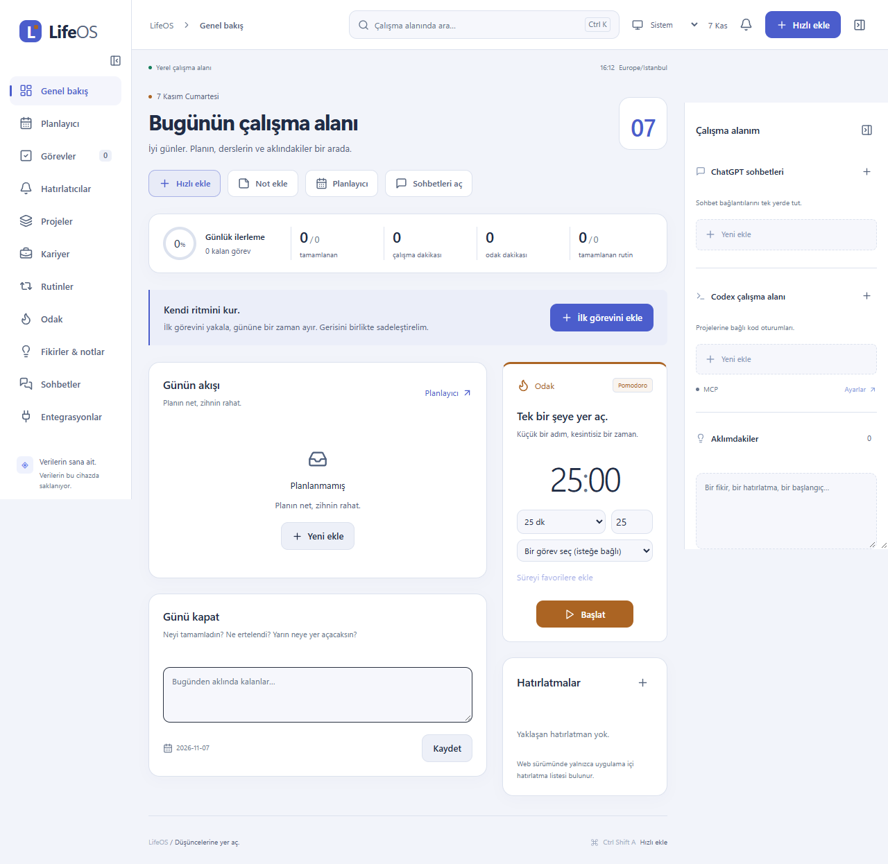
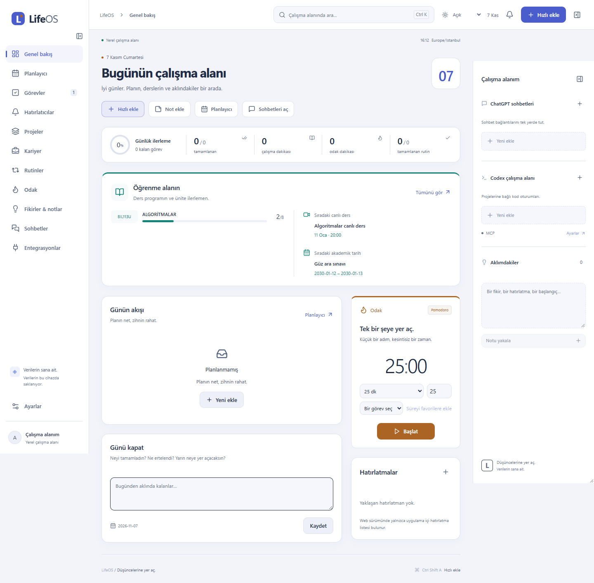
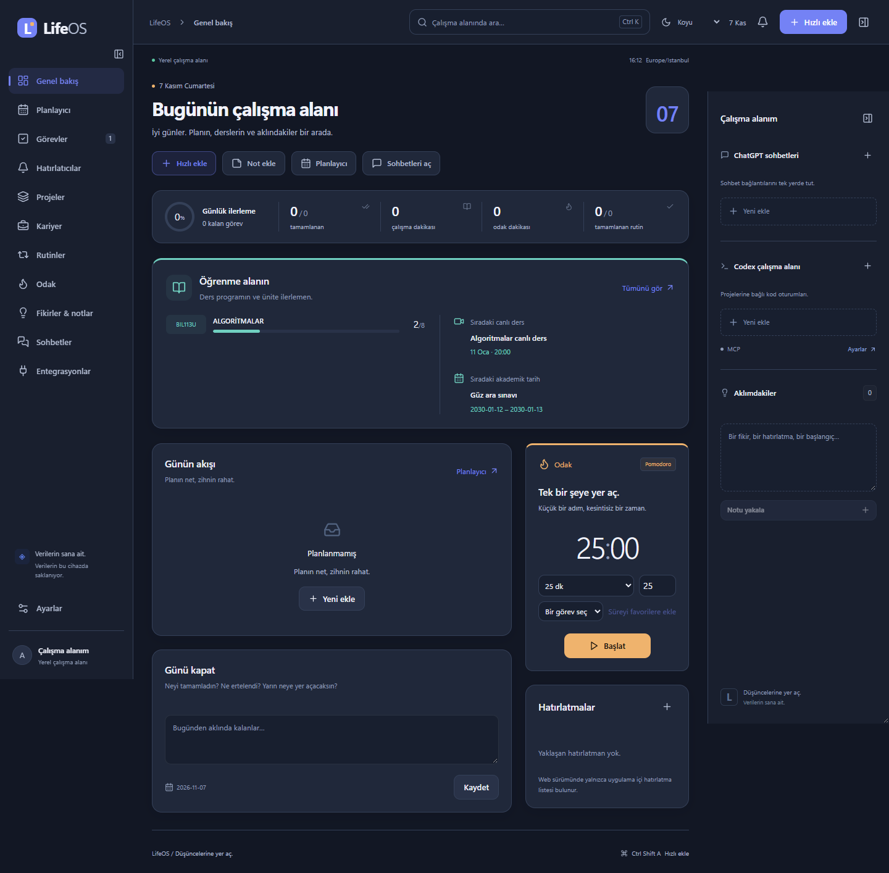
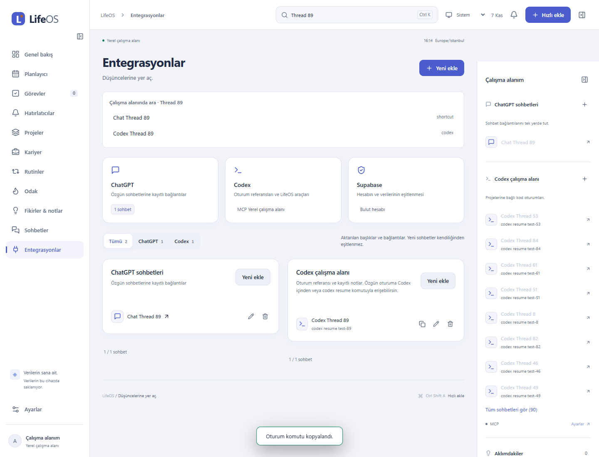

# LifeOS

**Düşüncelerine yer aç.** Görev, ders, rutin, not ve odak çalışmaların için kişisel Windows uygulaması. Yerel SQLite, isteğe bağlı Supabase eşitlemesi; reklam, analitik, ücretli AI ve herkese açık kayıt yok.



## Windows kurulumu

1. [Başarılı Actions çalışmasından](https://github.com/eFurkanSngl/LifeOS/actions/workflows/checks.yml) `lifeos-windows-unsigned` paketini indir.
2. İçindeki `LifeOS_0.1.0_x64-setup.exe` dosyasını kur. Paket şu an imzasızdır.
3. Yerel kullanım giriş istemez. Bulut için Ayarlar’dan önceden oluşturulmuş hesabına giriş yap.
4. Ayarlar’dan bildirim testi gönder. Windows **Rahatsız etmeyin**, oyun ve tam ekran kuralları banner ve sesi engelleyebilir.
5. Açılışta başlatma ve tepsi davranışı kullanıcı tercihidir. Hatırlatıcı için LifeOS işlemi açık kalmalı; uygulama kapalı bilgisayarı uyandıramaz.

`Ctrl+Shift+A`: global hızlı görev ekleme. `Ctrl+K`: uygulama içi arama. Global kısayol başka uygulamadaysa kaydı başarısız olabilir; uygulama çalışmaya devam eder.

## Özellikler

Üst çubuktaki **Tema seçimi** ile Açık, Koyu veya Sistem görünümünü seçebilirsin. Tercih bu cihazda korunur. Ana sayfada ders/PDF özeti ve hızlı işlemler, sol menüde doğrudan **Sohbetler** bulunur. Codex kaydındaki kopyalama düğmesi devam komutunu verir.




| Alan              | İşlev                                                                                   |
| ----------------- | --------------------------------------------------------------------------------------- |
| Görev ve projeler | Öncelik, kategori, bağımsız tekrar kayıtları, kanban, kilometre taşları                 |
| Eğitim            | Canlı ders / sınav / PDF filtreleri, tamamlanan/toplam ünite, kaynak bağlantıları, saat atanmayan sınav aralıkları |
| Takvim            | Gün/hafta/ay; gün görünümünde 15 dakikalık sürükleme; Alt+yön tuşlarıyla taşıma         |
| Hatırlatıcı       | Kalıcı kuyruk, ses, erteleme, yeniden planlama, sessiz saat ve gönderim geçmişi         |
| Rutin             | Günlük, hafta içi, haftalık hedef ve frekansa uygun seri                                |
| Not               | Otomatik kayıt, güvenli Markdown önizleme, taslak çakışması koruması, göreve dönüştürme |
| Odak              | Zaman damgalı sayaç, duraklat/devam, özel favori süre, geçmiş                           |
| Kariyer           | Kişiler, başvurular, görüşmeler, takip hatırlatmaları                                   |
| Çalışma alanı     | ChatGPT bağlantıları, manuel Codex referansları, kalıcı panel genişliği                 |
| Veri              | JSON yedek/geri yükleme, sürüm koruması, kaydedilmemiş form ve native kapatma uyarısı   |

Markdown başlık, liste, kalın metin ve kodu destekler. HTML çalıştırmaz ve uzak görsel yüklemez; tam bir Markdown editörü değildir.

## Ders takvimi


Anadolu eKampüs’te görünen beş ileri tarihli oturum kaynak başlangıç/bitiş saatleriyle aktarıldı. Her biri **30 dakika önce sesli uyarır**. Aktarım öncesi yerel yedek alındı. Aktarım tek seferliktir; program değişikliklerini otomatik izlemez. Uyarının gerçek ders saatindeki teslimi ayrıca canlı test gerektirir.

Görevler’de **Ders ekle**, **Sınav tarihi ekle**, **PDF takibi ekle** ve **Hatırlatıcı ekle** düğmeleri vardır. PDF ilerlemesi tamamlanan/toplam ünite olarak tutulur; +/− ile değiştirilir. Sınav aralıkları tüm gün kaydıdır: kişisel oturum saati bilinmeden saat üretilmez. Bağımsız uyarılar **Hatırlatıcılar** sayfasından düzenlenir.

Ayrıntılar: [Eğitim kayıtları](docs/EDUCATION.md).

## Codex’ten not ve görev ekleme



Codex için yerel `lifeos` MCP kaydı kuruldu ve gerçek not yazma/okuma testi geçti. Entegrasyonlar ekranı ChatGPT bağlantıları ve Codex oturum referanslarını arar; sağ panel ilk sekizini, ana liste ilk kırkını gösterir. **Daha fazla sohbet göster** ile devam edilir. Yukarıdaki görüntü test kayıtları içerir; kişisel sohbet başlıkları depoya eklenmez. Geçmiş aktarımı başlık/bağlantı indeksidir; tam mesajlar özgün uygulamada kalır. Otomatik devamlı eşitleme ve Codex masaüstü deep-link desteği yoktur.

Yerel **MCP sunucusu** 12 sınırlı araç sunar. Bağlantı kurulduktan sonra istemciye “LifeOS’a bu görüşmenin notunu ekle” veya açık tarih/saatle görev oluşturma talebi verilebilir.

1. LifeOS Ayarlar’dan yerel MCP erişimini etkinleştirip kaydet.
2. **Veritabanı yolu** düğmesiyle gerçek SQLite yolunu bul.
3. [MCP rehberindeki](docs/MCP_INTEGRATION.md) stdio yapılandırmasını Codex’e ekleyip bağlantıyı yenile.

Web yayını ve ücretli API gerekmez. ChatGPT desteği kullanılan istemcinin yerel MCP yeteneğine bağlıdır. Otomatik devamlı sohbet aktarımı yoktur. Bu kurulumda kullanıcının talebiyle Codex ayarlarına `lifeos` eklendi; diğer MCP kayıtları korundu.

## Doğrulama ve sınırlar

**69 otomatik test, 21 tarayıcı akışı**, TypeScript, lint ve üretim derlemeleri geçti. Native kontrol/test/paket sonucu Actions’ta ayrıca izlenir. Önceki kurulu pakette gerçek bulut girişi, masaüstü→Supabase→masaüstü aktarımı, temiz yeniden başlatmada oturum/kayıt korunumu ve tek arka plan gönderimi doğrulandı. Kullanıcı bildirim ve sesin çalıştığını doğruladı.

Yeni global kısayol ve native form kapatma koruması dahil [canlı test listesi](docs/LIVE_TEST.md) henüz bütünüyle kapanmış değildir. Uyku/çökme/tepsi ve toast eylemlerinin tam matrisi açıktır. Ana JS yaklaşık 744 kB’den 615 kB’ye indi; bu RAM ölçümü değildir. **60–120 MiB bellek hedefi henüz sağlandı diye raporlanmıyor.**

Web kullanımı/yayını ve iki istemci kabul testi kullanıcı tercihiyle ertelendi. Veri modeli sürümlü tipli zarflardır; tam normalize ilişkisel model, incremental/realtime sync ve otomatik Codex keşfi ayrıca açıktır.

Kurulu bellek iyileştirmeli pakette tek örnek ölçümleri: takvim ön planda yaklaşık **414 MiB**, Windows Ayarlar arkasında **54 MiB** toplam çalışma kümesi. Arka plandaki özel ayrılmış bellek yaklaşık 225 MiB’dir; bu farklı bir metriktir. Ölçüm sınırları [PERFORMANCE](docs/PERFORMANCE.md) dosyasındadır.

## Geliştirme

Node.js 24, pnpm 11.25.0. Native kaynak derlemesi Rust, Visual Studio C++ araçları ve Windows SDK ister. Bu makinede yerel kaynak derlemesi MSVC linker eksikti; Windows CI installer üretir.

```powershell
pnpm install --frozen-lockfile
pnpm dev:desktop                         # Tarayıcı önizlemesi; native bildirim değildir
pnpm desktop                             # Gerçek Tauri uygulaması
pnpm --filter @lifeos/desktop tauri build
pnpm typecheck
pnpm lint
pnpm test
pnpm build
pnpm test:e2e
```

```text
apps/desktop          Vite + React + Tauri/Rust
apps/web              Ertelenen Next.js istemcisi
packages/ui           Türkçe arayüz
packages/core         Zaman, tekrarlar, hedef ve seri
packages/validation   Zod doğrulaması
packages/database     SQLite / IndexedDB / native IPC
packages/integrations Supabase giriş ve eşitleme
services/mcp-server   Yerel stdio MCP
supabase              Şema ve migration
```

[Kurulum](docs/SETUP.md) · [Canlı test](docs/LIVE_TEST.md) · [Native doğrulama](docs/NATIVE_VERIFICATION.md) · [Bulut](docs/CLOUD_VERIFICATION.md) · [Mimari](docs/ARCHITECTURE.md) · [Güvenlik](docs/SECURITY.md) · [Kalanlar](docs/ROADMAP.md)

Yedekler kişisel kayıt içerir; özel sakla. Auth parolaları kayıt yedeklerine konmaz. Depo özeldir; açık kaynak lisansı verilmemiştir.

## Son kurulum durumu — 7 Kasım 2026

`2501368` Windows paketi kuruldu. Yerel veride 5 canlı ders, **tamamı 0/8 olan 5 PDF**, 5 sınav dönemi ve 4 sınav merkezi tercih son günü var. Akademik tarihler için **bir gün önce 18.00** saatinde 9 bağımsız hazırlık uyarısı oluşturuldu. Kesin kişisel sınav oturum saatleri henüz girilmedi. Canlı derslerin 30 dakika önceki sesli uyarı ayarları korundu.

Ayrı Hatırlatıcılar sayfasındaki sekiz kayıt sınırı kaldırıldı. [Başarılı derleme](https://github.com/eFurkanSngl/LifeOS/actions/runs/42289599511) 66 otomatik test ve 19 tarayıcı akışını içerir. Son güncelleme sonrası veri kontrolü geçti; son paketin native ekran kontrolü masaüstü kontrol aracının oturum hatası nedeniyle açık. [Eğitim ayrıntıları](docs/EDUCATION.md).

## Sohbet geçmişi ve MCP — 7 Kasım 2026

Sohbet ekranını içeren `0bed913` paketi kuruldu. Kullanıcının isteğiyle tüm erişilebilir geçmişin indeksi aktarıldı: **1.280 ChatGPT bağlantısı + 181 Codex oturum referansı** (11'i arşivlenmiş). Tam mesaj içerikleri özgün uygulamada kalır. Tekrar aktarım 1.461 kaydı atladı; çoğaltma olmadı. Beş PDF sayacı 0/8 kaldı.

MCP bu sohbetin gerçek araç listesinden de doğrulandı: kurulum notu ve mevcut görevler okunabildi. LifeOS'ta **Entegrasyonlar** sayfasını açıp üst aramayı kullan. ChatGPT bağlantısı özgün sohbeti açar; Codex kaydında oturum referansı bulunur. Sürekli otomatik sohbet eşitlemesi ve Codex masaüstü deep-link açma ayrıca geliştirilmelidir.
