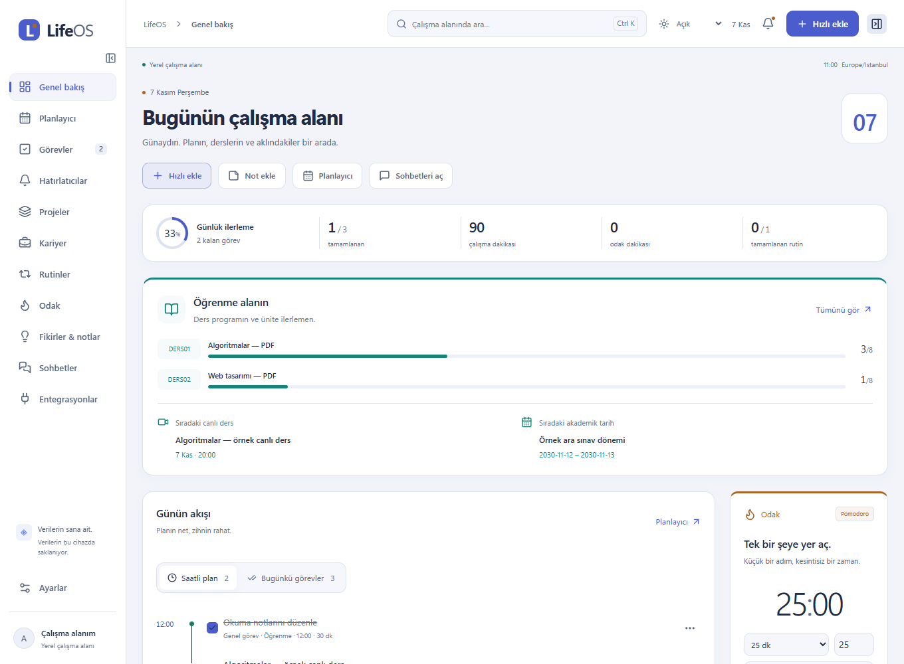
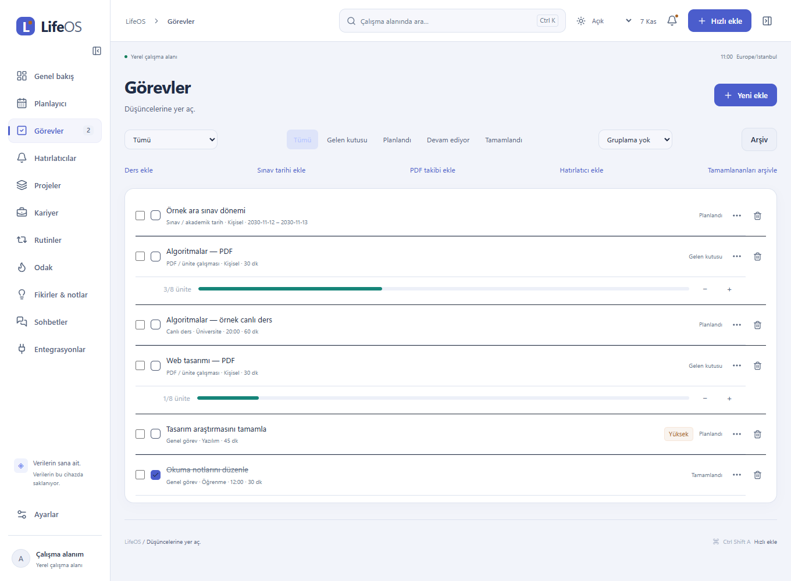
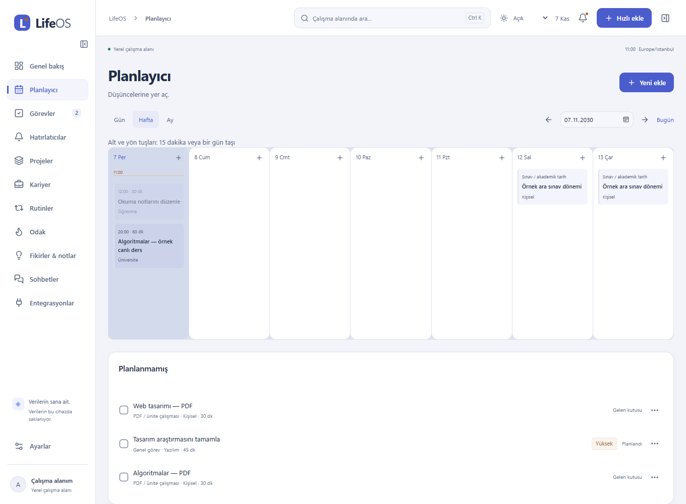
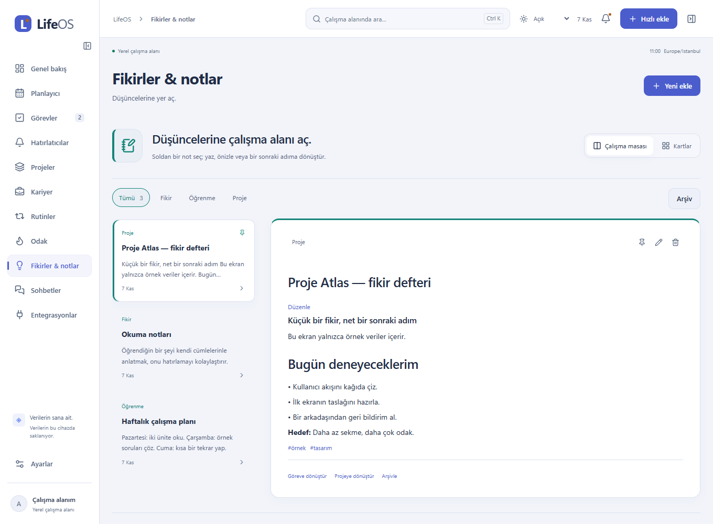
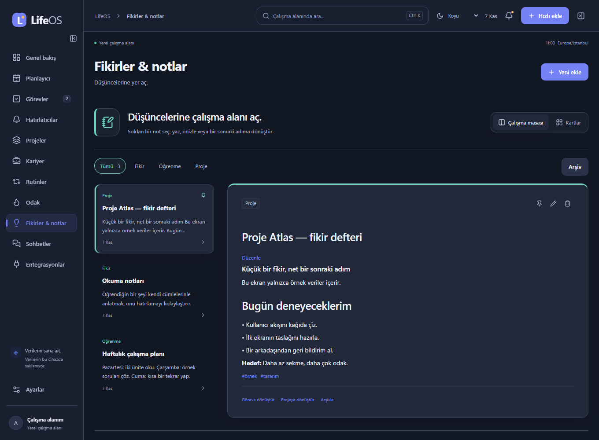
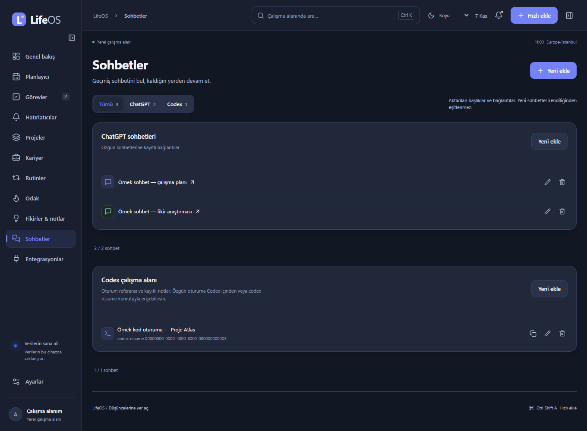

# LifeOS

**Düşüncelerine yer aç.** Görevlerini, derslerini, notlarını ve odak çalışmalarını tek bir Windows çalışma alanında topla.

LifeOS; kişisel kullanım için geliştirilen, verilerini önce cihazında saklayan bir masaüstü uygulamasıdır. Yerel kullanım için hesap açman gerekmez. Bulut eşitlemesi ve Codex bağlantısı isteğe bağlıdır. Reklam, analitik, ücretli AI bağımlılığı ve herkese açık kayıt yoktur.

> **Görseller hakkında:** Bu README’deki bütün ekranlar uygulamanın çalışan arayüzünden, yalnızca kurgu kayıtlarla üretilmiştir. Proje Atlas, DERS01, örnek sohbetler, tarihler ve ilerleme sayıları yer tutucudur. Gerçek kişinin ders programı, e-postası, sohbeti, müşteri bilgisi veya hesap ekranı gösterilmez. Görsele tıklayarak tam boy açabilirsin.

[](docs/screenshots/overview-demo.png)

**İçindekiler:** [Kurulum](#windows-kurulumu) · [İlk kullanım](#ilk-10-dakika) · [Ekranlar](#ekran-ekran-kullanım) · [Bildirimler](#bildirimler-nasıl-çalışır) · [Veriler ve yedek](#verilerin-ve-yedeklerin) · [Codex/MCP](#codex-ve-mcp) · [Spotify ve medya](#spotify-görseller-ve-ses-kayıtları) · [Test durumu](#test-durumu-ve-bilinen-sınırlar) · [Geliştirme](#geliştiriciler-için)

## Windows kurulumu

1. Depoya erişimin varsa [GitHub Actions](https://github.com/eFurkanSngl/LifeOS/actions/workflows/checks.yml) sayfasındaki **başarılı** bir çalışmayı aç.
2. **Artifacts → lifeos-windows-unsigned** paketini indir ve ZIP dosyasını aç. Artifact indirmek GitHub oturumu gerektirebilir.
3. `LifeOS_0.1.0_x64-setup.exe` dosyasını çalıştır. Bu geliştirme paketi henüz kod imzalı değildir.
4. LifeOS’u aç. İlk açılışta boş çalışma alanı görmen normaldir; örnek görsellerdeki kayıtlar uygulamaya otomatik eklenmez.
5. **Ayarlar → Bildirim testi gönder** ile kendi bilgisayarındaki teslimi dene.

Windows 10/11 ve WebView2 çalışma zamanı gerekir. macOS/Linux için kurulum paketi ve doğrulama sunulmuyor. Web istemcisi kaynak kodda bulunur; yayımlanmış bir web hizmeti bu teslimin parçası değildir.

**Güncelleme:** Açık formunu kaydet, LifeOS’tan tamamen çık ve yeni installer’ı aynı kurulum konumuna uygula. Güncellemeden önce JSON yedeği almak iyi bir alışkanlıktır. Normal güncelleme yerel kayıtları sıfırlamaz; doğrulama sınırları aşağıdadır.

## İlk 10 dakika

1. Üst çubuktaki **Tema seçimi** ile Açık, Koyu veya Sistem seç. Tema tercihi bu cihazda saklanır.
2. **Hızlı ekle** ile ilk görevini oluştur. İstersen yalnızca başlık gir; gün ve saat atamak zorunlu değildir.
3. **Görevler** sayfasından görevini düzenle, planla veya tamamla. Ders, sınav ve PDF kayıtları için ayrı ekleme düğmelerini kullan.
4. **Fikirler & notlar** sayfasında bir not aç. Çalışma masasında soldan not seç; sağda düzenle veya Markdown önizlemesini aç.
5. **Odak** bölümünde süre seçip çalışmayı başlat. Bir göreve bağlamak isteğe bağlıdır.
6. **Ayarlar** üzerinden yedek al. Bulut veya MCP kullanmayacaksan bunları açman gerekmez.

| Kısayol             | İşlem                                                                 |
| ------------------- | --------------------------------------------------------------------- |
| `Ctrl+K`            | Uygulama içinde aramaya git                                           |
| `Ctrl+Shift+A`      | LifeOS çalışırken Windows’tan hızlı ekleme formunu aç                 |
| `Escape`            | Formu kapatmayı iste; kaydedilmemiş değişiklik varsa onay gösterilir  |
| `Alt` + yön tuşları | Takvimin gün görünümünde seçili saatli kaydı 15 dakika / bir gün taşı |

Başka uygulamalar global kısayolu kullanıyorsa kayıt başarısız olabilir; LifeOS’un kendi ekleme düğmeleri kullanılabilir.

## Ekran ekran kullanım

### Genel bakış: günü aç

Ana ekran; o günün görevlerini, öğrenme ilerlemesini, sıradaki ders/sınavı ve odak sayacını bir araya getirir. **Saatli plan** ile zaman çizelgesini, **Bugünkü görevler** ile günü atanmış bütün görevleri görürsün. Hızlı işlemlerden görev, not, takvim ve sohbetlere geçebilirsin.

Sayaçlar kayıtlarından hesaplanır. Örnekteki çalışma süresi, kategoriye göre planlanan görev süreleridir; otomatik cihaz takibi veya gerçekten çalıştığın süre iddiası değildir. Gerçek odak oturumları ayrı tutulur. Kaydın yoksa boş durum ve ekleme adımları gösterilir.

### Görevler, dersler ve PDF ilerlemesi

[](docs/screenshots/tasks-demo.png)

- **Genel görev:** başlık, açıklama, öncelik, kategori, gün/saat ve süre.
- **Canlı ders:** ders kodu, kaynak bağlantısı ve programdaki başlangıç saati.
- **Sınav / akademik tarih:** bir gün veya tarih aralığı. Kesin oturum saati bilinmiyorsa tüm gün kaydı kullanılır.
- **PDF / ünite çalışması:** tamamlanan ünite / toplam ünite. `+` ve `−` ile ilerlemeyi güncelle; toplamı aşan değer kabul edilmez. Bu özellik PDF dosyasını okuyup tamamladığın üniteyi kendiliğinden çıkarmaz.
- **Tekrarlar:** tekrar serisi ve bağımsız gerçekleşme kayıtları ayrı yönetilir; birini tamamlamak bütün seriyi tamamlamaz.

Filtrelerle canlı ders, sınav veya PDF kayıtlarını ayırabilirsin. Kişisel ders programı aktarımı tek seferliktir; üniversite sitesindeki değişiklikler otomatik izlenmez. Yeni kullanıcıların kendi derslerini eklemesi gerekir.

### Planlayıcı: güne ve haftaya bak

[](docs/screenshots/calendar.png)

Gün, hafta ve ay görünümleri vardır. Saatli kaydı gün görünümünde sürükleyerek 15 dakikalık aralıklarla taşıyabilirsin. Klavye alternatifi de bulunur. Tüm gün sınav aralıkları saat uydurulmadan ilgili günlerde görünür.

Takvim kaydı ile hatırlatıcı aynı şey değildir: yalnızca takvime tarih koymak, istediğin erken uyarıyı kendiliğinden garanti etmez. Görev formundaki hatırlatma seçeneğini ve dakika farkını kontrol et. Bağımsız uyarılar için **Hatırlatıcılar** sayfasını kullan.

### Notlar: düşünceyi işle

[](docs/screenshots/notes-demo.png)

**Çalışma masası** görünümünde notlar solda, seçili notun editörü sağdadır. Kategori düğmeleriyle listeyi daraltabilir, arşive geçebilir ve önemli notları sabitleyebilirsin. **Kartlar** seçeneği bütün notları kart düzeninde gösterir; görünüm tercihi bu cihazda korunur.

Not gövdesi kısa bir gecikmeden sonra otomatik kaydedilir. Yerel taslak, notlar arasında geçişte korunur. Aynı not başka bir yerde değişirse sessizce üzerine yazmak yerine çakışma uyarısı gösterilir; taslağı ayrı not olarak saklayabilirsin.

**Önizleme**; başlık, liste, kalın metin ve kod gibi temel Markdown öğelerini gösterir. HTML çalıştırmaz ve uzak görsel yüklemez. **Göreve dönüştür** / **Projeye dönüştür**, nottan yeni kayıt oluşturacak formu açar; özgün not silinmez.

[](docs/screenshots/notes-dark-demo.png)

### Odak, rutinler ve projeler

| Alan     | Nasıl kullanılır?                                                                                                        |
| -------- | ------------------------------------------------------------------------------------------------------------------------ |
| Odak     | Süre seç, istersen görev bağla, başlat; duraklat/devam et ve favori sürelerini sakla. Geçmiş oturumları sonradan incele. |
| Rutinler | Günlük, hafta içi veya haftalık hedef belirle; hedefe uygun miktarı kaydet. Seri hesabı seçilen sıklığa göre yapılır.    |
| Projeler | Görevleri projeye bağla, kanban ve kilometre taşlarıyla ilerlemeyi düzenle.                                              |
| Kariyer  | Kişileri, başvuruları, görüşmeleri ve takip tarihlerini tut. Kimseye kendiliğinden e-posta/mesaj gönderilmez.            |
| Gün sonu | Ana ekrandaki değerlendirmeye tamamladıklarını ve ertesi güne bırakacaklarını yaz.                                       |

### Sohbetler: bağlantıları bir araya getir

[](docs/screenshots/conversations-demo.png)

**Sohbetler** sayfasında ChatGPT bağlantıları ile Codex oturum referanslarını arayabilir ve kaynağa göre ayırabilirsin. ChatGPT bağlantısı özgün sohbeti açar. Codex kaydında **Devam komutunu kopyala** düğmesi kayıtlı `codex resume …` komutunu verir; oturumun aynı ortamda mevcut olması gerekir.

Büyük listeler ilk 40 kayıtla açılır; **Daha fazla sohbet göster** ile devam edilir. Sağ çalışma alanı ilk sekiz referansı gösterir. Sağ panel daraltılabilir ve genişliği ayarlanabilir.

**Bu bir tam sohbet arşivi değildir.** Kayıtlar başlık, bağlantı/referans ve kayıtlı notlardan oluşur. Tam mesaj metinleri özgün uygulamalarda kalır. Yeni sohbetlerin devamlı otomatik aktarımı ve Codex masaüstü sohbetini doğrudan açan deep-link desteği henüz yoktur. Örnek görsellerdeki bağlantı ve UUID’ler yer tutucudur.

## Bildirimler nasıl çalışır?

LifeOS’un hatırlatıcıları Windows uygulamasındaki kalıcı native kuyruktan işlenir. Tarayıcı zamanlayıcısı native kuyruk yerine kullanılmaz.

1. Bir görev için saat ve hatırlatma farkı seç veya bağımsız hatırlatıcı oluştur.
2. **Ses** seçeneğini ve **Sessiz saatler** ayarını kontrol et.
3. Hatırlatıcı saatinde LifeOS işlemi çalışıyorsa native kuyruk Windows’a bildirim göndermeyi dener.
4. Erteleme veya yeniden planlama yeni zamanı kaydeder. Geçmişteki **Gönderim istendi** durumu, Windows’un banner’ı gerçekten gösterdiğini veya sesi çaldığını kanıtlamaz.

**Önemli kullanım sınırları:**

- Pencereyi kapatma davranışı Ayarlar’da seçilir. Tamamen çıkarsan bilgisayar kapalıyken/uykudayken LifeOS uyarı veremez ve bilgisayarı uyandıramaz.
- Açılışta süresi geçmiş bekleyen kayıtlar yeniden değerlendirilir; bu, gerçek saatinde teslim garantisi değildir.
- Windows **Rahatsız etmeyin**, oyun/tam ekran ve ses ayarları banner/sesi engelleyebilir.
- Sessiz saatlerde uyarı bekletilir. Windows açılışında otomatik başlatma yalnızca sen etkinleştirirsen açılır.
- Toast eylemleri ve uyku/uyanma dahil bütün yaşam döngüsü senaryoları henüz canlı kabulden geçmedi. [Canlı test listesi](docs/LIVE_TEST.md).

## Verilerin ve yedeklerin

| Konu                | Davranış                                                                                                           |
| ------------------- | ------------------------------------------------------------------------------------------------------------------ |
| Yerel kayıt         | Windows uygulamasında SQLite; tarayıcı önizlemesinde ayrı IndexedDB. İki ortam aynı yerel veritabanını kullanmaz.  |
| Bulut               | İsteğe bağlı Supabase. Kullanıcıya ait kayıtlar RLS ile ayrılır. Service-role anahtarı istemciye konmaz.           |
| Yedek               | Ayarlar’dan JSON dışa aktar/geri yükle. Yedek kayıt ve tombstone’ları içerir; özel saklanmalıdır.                  |
| Tekrar geri yükleme | Var olan kayıtlar çoğaltılmaz; daha yeni düzenlemeleri koruyan sürüm denetimi vardır.                              |
| Silme               | Eşitlemede kaydın silindiğini taşıyan tombstone kullanılır; sürüm bilgisi korunur.                                 |
| Parola              | Auth parolası uygulama kayıtlarına veya JSON yedeğine yazılmaz. Native oturum Windows credential storage kullanır. |

**Arkadaşlarına verirken:** Her kişi kendi yerel çalışma alanını kullanmalı. Kişisel SQLite dosyanı, yedeğini, `.env.local` dosyanı veya Codex ayarlarını installer’a ekleme. Mevcut özel bulut hesabının parolasını paylaşma. Bulut kullanacak kişilerin kendi hesabı ve doğru proje yapılandırması gerekir; bu sürüm kendi kendine kayıt açan bir SaaS değildir.

JSON yedeğinin nasıl geri alınacağını boş bir test profiliyle denemek, yalnızca yedeğin var olduğunu bilmekten daha güçlü bir kontroldür. Gerçek profilini test uğruna silme. [Yapılandırma](docs/SETUP.md) · [Güvenlik](docs/SECURITY.md).

## Codex ve MCP

Yerel `lifeos` MCP sunucusu; istemcinin açık talebiyle not, görev, hatırlatıcı ve diğer sınırlı işlemleri sunar. Web yayını veya ücretli AI API’si gerektirmez. Kullanılan AI istemcisinin kendi aboneliği/koşulları ayrıdır.

1. LifeOS’ta **Ayarlar → Yerel MCP erişimini etkinleştir** seçeneğini kaydet.
2. **Veritabanı yolu** ile o kurulumun gerçek SQLite yolunu al.
3. [MCP kurulum rehberindeki](docs/MCP_INTEGRATION.md) stdio tanımını kendi Codex istemcine uygun mutlak yollarla ekle.
4. Bağlantıyı yenile ve önce not/görev listesini okuyarak doğrula.

Örnek talepler:

- “LifeOS’a Proje Atlas başlıklı bir not ekle; bugün kararlaştırdığımız üç adımı yaz.”
- “LifeOS’taki yarınki görevlerimi göster.”
- “10 Kasım 2030 saat 19.30, Europe/Istanbul için tekrar görevini ve hatırlatıcıyı oluştur.”

Bu, Codex’in geçmiş sohbetlerini otomatik okuyan bir entegrasyon değildir. ChatGPT erişimi kullanılan istemcinin yerel MCP desteğine bağlıdır; bu depodaki kurulumun bütün ChatGPT istemcilerinde çalıştığı iddia edilmez.

## Spotify, görseller ve ses kayıtları

Bunlar mevcut sürümde tamamlanmış özellikler değildir. Tasarım ve sınırları [entegrasyon planında](docs/INTEGRATIONS_NEXT.md) tutulur.

| Fikir       | Önerilen ilk kapsam                                                                                       | Henüz sunulmayanlar                                          |
| ----------- | --------------------------------------------------------------------------------------------------------- | ------------------------------------------------------------ |
| Spotify     | Windows’ta açık Spotify’ın parça bilgisi, oynat/duraklat, önceki/sonraki kontrolü için yerel medya paneli | Spotify OAuth, telefon/cihaz geçişi, gömülü müzik akışı      |
| Nota görsel | Panodan yapıştırma veya dosya seçimi; nota bağlı yerel görsel eki                                         | Çalışır ek deposu, medya yedeği ve bulut yüklemesi           |
| Ses kaydı   | Kullanıcının başlattığı, açık kayıt göstergeli kısa ses eki                                               | Mikrofon erişimi, kalıcı ses deposu, otomatik transkripsiyon |

Spotify’ın resmî [oynatma API’si](https://developer.spotify.com/documentation/web-api/reference/start-a-users-playback) Premium gerektirir. API ile dağıtım ayrıca geliştirici uygulaması, OAuth ve güncel kota kurallarına bağlıdır. Windows yerel medya yolu farklıdır; kullanılabilirlik gerçek Spotify oturumuyla doğrulanmadan çalışıyor diye sunulmayacaktır.

## Test durumu ve bilinen sınırlar

Bu bir geliştirme sürümüdür. Son kapsamda **71 birim testi ve 22 tarayıcı akışı** vardır. Otomatik testler; not taslağı koruması, görünüm değişimi, temalar, PDF ilerlemesi, görevler, takvim, yedek, cloud şeması ve diğer kritik davranışları kapsar. Kaynak commit’in Windows kontrol/test/installer sonucunu [Actions](https://github.com/eFurkanSngl/LifeOS/actions/workflows/checks.yml) üzerinden ayrıca kontrol et.

`e45e978` Windows paketi [başarılı derlemeden](https://github.com/eFurkanSngl/LifeOS/actions/runs/42381403378) kuruldu. Yeni not çalışma masası ve kart görünümü gerçek Windows penceresinde kontrol edildi. Güncelleme öncesi/sonrası karşılaştırmada 1.501 kaydın içeriği ve silinme işaretleri aynı kaldı. Önceki sürümde gerçek bulut giriş/aktarım, oturum korunumu, ayrı SQLite profilinde dolu yedek geri yükleme ve tekil native kuyruk gönderimleri doğrulanmıştı; kullanıcı Settings bildiriminde banner ve sesi doğruladı. Bunlar her native senaryonun yeni sürümde tekrarlandığı anlamına gelmez. Ayrıntılar [native doğrulama](docs/NATIVE_VERIFICATION.md) dosyasında tutulur.

Açık alanlar: uyku/uyanma ve ani çökme pencereleri, toast eylemlerinin tamamı, gerçek oturum yenileme/rotation, fiziksel ağ kesintisi/geri bağlantı ve iki istemci kabulü. Web yayını ertelendi. Tam transcript aktarımı, incremental/realtime sync ve normalize ilişkisel model tamamlanmış sayılmaz.

Animasyonlar yalnızca açma, basma, seçim ve hover geri bildirimlerinde kısa CSS geçişleridir; sürekli çalışan arka plan animasyonu eklenmedi. **Azaltılmış hareket** sistem tercihi uygulanır. Bellek için ilk şartnamedeki 60–120 MB bir iyileştirme hedefidir; garanti veya sağlanmış kabul koşulu değildir. [Gerçek ölçümler ve sınırları](docs/PERFORMANCE.md).

## Geliştiriciler için

Node.js 24, pnpm 11.25.0. Windows native derlemesi için Rust, Visual Studio C++ Build Tools ve Windows SDK gerekir. Windows CI ayrıca installer üretir.

```powershell
pnpm install --frozen-lockfile
pnpm dev:desktop                         # Tarayıcı önizlemesi, native bildirim değildir
pnpm desktop                             # Gerçek Tauri uygulaması
pnpm --filter @lifeos/desktop tauri build
pnpm typecheck
pnpm lint
pnpm test
pnpm build
pnpm test:e2e
```

Bulut isteğe bağlıdır. `.env.example` dosyasındaki **public URL ve publishable key** girdilerini ilgili istemcinin `.env.local` dosyasına kendi projen için koy. Service-role anahtarı veya veritabanı parolası ekleme. Kişisel `.env.local`, SQLite dosyaları, yedekler ve `.tools` Git’e dahil edilmez. Şemayı kurulmuş bir projeye tekrar uygulamadan önce migration geçmişini kontrol et.

```text
apps/desktop          Vite + React + Tauri/Rust
apps/web              Ertelenen Next.js istemcisi
packages/ui           Merkezi Türkçe kopyalar ve ortak arayüz
packages/core         React bağımsız zaman, tekrar ve hedef kuralları
packages/validation   Harici girdiler için Zod doğrulaması
packages/database     SQLite / IndexedDB / native IPC
packages/integrations Supabase giriş ve eşitleme
services/mcp-server   Sınırlı yerel stdio MCP
supabase              Sürümlü şema ve migration dosyaları
```

**Görselleri yeniden üretmek:** Üretim web derlemesinden sonra `pnpm exec playwright test tests/e2e/presentation.spec.ts` çalıştır. Test, izole tarayıcı veritabanına yalnızca kaynakta tanımlı kurgu kayıtlar ekler; native SQLite veya bulut hesabını okumaz. [Görsel envanteri](docs/screenshots/README.md).

[Kurulum](docs/SETUP.md) · [Canlı test](docs/LIVE_TEST.md) · [Native](docs/NATIVE_VERIFICATION.md) · [Bulut](docs/CLOUD_VERIFICATION.md) · [Mimari](docs/ARCHITECTURE.md) · [Tasarım](docs/DESIGN.md) · [Kalanlar](docs/ROADMAP.md)

Depo herkese açık olarak görüntülenebilir. Uygulamayı denemek için Windows kurulum paketini kullanabilirsin. Kişisel veriler ve yerel ayarlar bu depoya dahil değildir.
